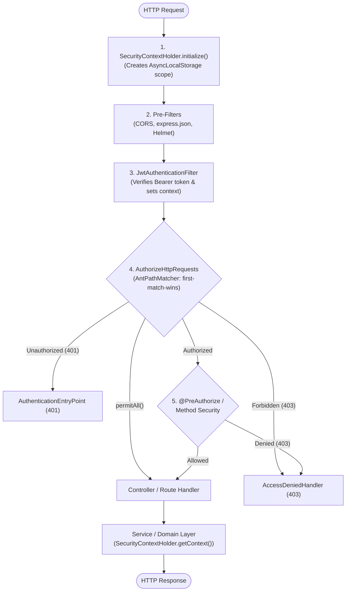

<p align="center">
  

</p>

#  Express Spring Security

> **Enterprise-grade Spring Security 6 architecture for Express & TypeScript applications — without the NestJS monolith.**

[](https://www.typescriptlang.org/)
[](https://expressjs.com/)
[](https://nodejs.org/)
[]()
[](https://opensource.org/licenses/ISC)

---

## 💡 Why Express Spring Security?

In the Node.js / TypeScript ecosystem, developers needing structured, enterprise-ready authentication and Role-Based Access Control (RBAC) face a tough choice:

1. **Adopt NestJS:** Forces your entire codebase into an opinionated, heavy framework (Angular-style modules, providers, controllers, and RxJS).
2. **Use Passport.js:** Dated, callback-heavy, lacking declarative security pipelines and ambient context.
3. **Ad-Hoc Custom Middleware:** Mutates `req.user` and requires drilling `req` down into every repository, domain service, and logger.

**`express-spring-security` bridges this gap.** It brings the beloved, battle-tested design patterns of **Spring Security 6** directly to Express with pure TypeScript:

* 🔒 **Fluent Security Filter Chain:** Declarative URL authorization (`requestMatchers`, Ant-style paths, first-match-wins semantics).
* 🧵 **ThreadLocal-style Context (`SecurityContextHolder`):** Ambient request context powered by Node's native `AsyncLocalStorage`. Access the authenticated user anywhere in your service layer without parameter-drilling `req`.
* 🛡️ **Universal `@PreAuthorize`:** Works on both **Stage 2** (`experimentalDecorators: true`) and **Stage 3** (TypeScript 5.0+ standard TC39 decorators), with automatic `this` binding and dynamic SpEL-style expression predicates.
* ⚡ **Dual Paradigm:** Use decorators on classes OR functional middleware (`hasRole`, `hasAnyRole`, `authenticated`, `authorize`) on plain Express routes.
* 🚦 **Pluggable Exception Handling:** Full separation of concerns between 401 Unauthorized (`AuthenticationEntryPoint`) and 403 Forbidden (`AccessDeniedHandler`).
* 🔑 **Pluggable Authentication Engine:** Unopinionated `PasswordEncoder` contract — you decide your hashing library (`bcrypt`, `argon2`, etc.) with zero forced dependencies — paired with `UserDetailsService`, `InMemoryUserDetailsManager`, and `AuthenticationManager`.
* 🏢 **Enterprise JWT & JWKS:** Symmetric secrets (`HS256`), Asymmetric keys (`RS256`, `ES256`), and dynamic JWKS key resolvers for Auth0, Okta, and Keycloak.

---

## 🔄 Request Lifecycle Architecture



---

## 📦 Installation

```bash
npm install express-spring-security jsonwebtoken cors
npm install -D @types/jsonwebtoken @types/cors
```

---

## 🚀 Quick Start (Complete Runnable Example)

```typescript
import express, { Request, Response } from 'express';
import {
  SecurityFilterChain,
  JwtAuthenticationFilter,
  SecurityContextHolder,
  PreAuthorize
} from 'express-spring-security';

const app = express();
const JWT_SECRET = 'your-256-bit-secret-key-goes-here';

// 1. Controller with Method Security
class UserController {
  public getPublicData(req: Request, res: Response) {
    res.json({ message: 'Public data open to anyone' });
  }

  @PreAuthorize('USER')
  public getUserProfile(req: Request, res: Response) {
    const auth = SecurityContextHolder.getContext();
    res.json({ message: `Hello ${auth.user?.username}!`, user: auth.user });
  }

  @PreAuthorize('ADMIN')
  public getAdminStats(req: Request, res: Response) {
    res.json({ cpu: '12%', memory: '48%' });
  }
}

// 2. Configure Security Pipeline (BEFORE routes)
new SecurityFilterChain(app)
  .cors()
  .addPreFilter(express.json())
  .addJwtAuthenticationFilter(new JwtAuthenticationFilter(JWT_SECRET))
  .authorizeHttpRequests(auth => auth
    // Public paths
    .requestMatchers('/api/public/**', '/api/auth/**').permitAll()
    // Role-based paths
    .requestMatchers('/api/admin/**').hasRole('ADMIN')
    .requestMatchers('/api/user/**').hasAnyRole('USER', 'ADMIN')
    // Catch-all: require authentication for any unmatched route
    .anyRequest().authenticated()
  )
  .apply();

// 3. Register Routes
const controller = new UserController();
app.get('/api/public/info', controller.getPublicData);
app.get('/api/user/profile', controller.getUserProfile);
app.get('/api/admin/metrics', controller.getAdminStats);

app.listen(3000, () => {
  console.log('🚀 Server running on http://localhost:3000');
});
```

---

## 🧩 Core Architecture & Features

### 1. Ambient Security Context (`SecurityContextHolder`)

Just like Java's `ThreadLocal`, `SecurityContextHolder` utilizes Node's native `AsyncLocalStorage`. Access the authenticated user anywhere in your service layer, logging pipeline, or database interceptors without parameter-drilling `req`:

```typescript
import { SecurityContextHolder } from 'express-spring-security';

export class OrderService {
  public async createOrder(items: string[]) {
    // Access context anywhere in the async call stack!
    const auth = SecurityContextHolder.getContext();
    const currentUser = auth.user;

    console.log(`Order created by ${currentUser?.username} (ID: ${currentUser?.id})`);
    return db.order.create({ data: { userId: currentUser?.id, items } });
  }
}
```

---

### 2. Method Security (`@PreAuthorize`)

Decorate your controller methods with role checks or dynamic ownership predicates. Auto-binds `this` so you can pass controller methods directly into Express router handlers without manual `.bind(this)`:

```typescript
import { Request, Response } from 'express';
import { PreAuthorize, SecurityContextHolder } from 'express-spring-security';

export class ArticleController {
  // Public method
  public getArticles(req: Request, res: Response) {
    res.json({ articles: [] });
  }

  // Requires 'ADMIN' or 'EDITOR' role
  @PreAuthorize(['ADMIN', 'EDITOR'])
  public publishArticle(req: Request, res: Response) {
    res.json({ message: 'Article published' });
  }

  // Dynamic Ownership Predicate (SpEL Alternative)
  // Only the author or an ADMIN can edit the article:
  @PreAuthorize((auth, req) => {
    return auth.user?.roles.includes('ADMIN') || String(auth.user?.id) === String(req.body.authorId);
  })
  public updateArticle(req: Request, res: Response) {
    res.json({ message: `Article ${req.params.id} updated` });
  }
}

// Clean route registration (no manual .bind needed!)
const controller = new ArticleController();
app.get('/api/articles', controller.getArticles);
app.post('/api/articles', controller.publishArticle);
app.put('/api/articles/:id', controller.updateArticle);
```

> **Decorator Compatibility:** Works seamlessly with both legacy decorators (`"experimentalDecorators": true`) and modern TypeScript 5.0+ TC39 standard decorators!

---

### 3. Functional Route Helpers (No Classes Required)

If your Express codebase is purely functional, you can protect routes using lightweight middleware helpers without classes or decorators:

```typescript
import { hasRole, hasAnyRole, authenticated, authorize } from 'express-spring-security';

// Require specific role
app.get('/api/admin/metrics', hasRole('ADMIN'), (req, res) => {
  res.json({ cpu: '12%' });
});

// Require any of multiple roles
app.get('/api/dashboard', hasAnyRole('USER', 'ADMIN'), (req, res) => {
  res.json({ view: 'Dashboard' });
});

// Require simple authentication
app.get('/api/profile', authenticated(), (req, res) => {
  res.json({ profile: 'Data' });
});

// Custom expression predicate
app.delete('/api/posts/:id', authorize((auth, req) => auth.user?.id === req.body.authorId), (req, res) => {
  res.json({ status: 'deleted' });
});
```

---

### 4. Pluggable Authentication Engine (`PasswordEncoder` & `UserDetailsService`)

`express-spring-security` provides an unopinionated contract: **the framework does not force any specific password hashing library upon you**. You implement `PasswordEncoder` using whatever hashing algorithm and library your team prefers (`bcrypt`, `argon2`, PBKDF2, scrypt, etc.).

#### Implementing `PasswordEncoder` with Your Chosen Library

```typescript
import bcrypt from 'bcrypt';
import {
  PasswordEncoder,
  AuthenticationManager,
  InMemoryUserDetailsManager
} from 'express-spring-security';

// 1. Implement PasswordEncoder with your preferred algorithm (e.g. bcrypt, argon2)
class BCryptPasswordEncoder implements PasswordEncoder {
  public async encode(rawPassword: string): Promise<string> {
    return bcrypt.hash(rawPassword, 10);
  }
  public async matches(rawPassword: string, encodedPassword: string): Promise<boolean> {
    return bcrypt.compare(rawPassword, encodedPassword);
  }
}

const passwordEncoder = new BCryptPasswordEncoder();
const hashedPassword = await passwordEncoder.encode('my-super-secret-password');

// 2. User details store (in-memory for testing, or implement UserDetailsService for your DB)
const userDetailsService = new InMemoryUserDetailsManager([
  {
    id: 1,
    username: 'john_doe',
    password: hashedPassword,
    roles: ['USER', 'ADMIN']
  }
]);

// 3. Authenticate credentials and mint signed JWTs
const authManager = new AuthenticationManager(userDetailsService, passwordEncoder, JWT_SECRET, '2h');

// In your login controller:
app.post('/api/auth/login', async (req, res) => {
  try {
    const token = await authManager.authenticate(req.body.username, req.body.password);
    res.json({ token });
  } catch (err: any) {
    res.status(401).json({ error: err.message });
  }
});
```

#### Database Integration (`UserDetailsService`)

Connect any database or ORM (Prisma, TypeORM, Drizzle, Mongoose) simply by implementing `loadUserByUsername`:

```typescript
import { UserDetailsService, UserDetails } from 'express-spring-security';
import { prisma } from './prisma';

export class PrismaUserDetailsService implements UserDetailsService {
  public async loadUserByUsername(username: string): Promise<UserDetails | null> {
    const user = await prisma.user.findUnique({
      where: { username },
      include: { roles: true }
    });

    if (!user) return null;

    return {
      id: user.id,
      username: user.username,
      password: user.passwordHash,
      roles: user.roles.map(r => r.name)
    };
  }
}
```

---

### 5. Enterprise Asymmetric Verification (RS256 & JWKS)

`JwtAuthenticationFilter` supports symmetric HMAC secrets, RSA/ECDSA public keys in PEM format, and dynamic JWKS key resolution (for Auth0, Okta, Keycloak, or key rotation):

```typescript
import { JwtAuthenticationFilter, SecurityFilterChain } from 'express-spring-security';
import fs from 'fs';

// --- Option A: Classic Symmetric Secret (HS256) ---
new SecurityFilterChain(app)
  .addJwtAuthenticationFilter(new JwtAuthenticationFilter('my-secret-key'))
  .apply();

// --- Option B: Asymmetric RS256 with Public Key PEM ---
new SecurityFilterChain(app)
  .addJwtAuthenticationFilter(new JwtAuthenticationFilter({
    secretOrPublicKey: fs.readFileSync('./public-key.pem'),
    algorithms: ['RS256'],
    issuer: 'https://auth.mycompany.com/',
    audience: 'https://api.mycompany.com'
  }))
  .apply();

// --- Option C: Dynamic JWKS Key Resolver (Auth0 / Okta / Keycloak) ---
new SecurityFilterChain(app)
  .addJwtAuthenticationFilter(new JwtAuthenticationFilter({
    keyResolver: async (header) => {
      // header.kid identifies the active signing key
      const key = await jwksClient.getSigningKey(header.kid);
      return key.getPublicKey();
    },
    algorithms: ['RS256']
  }))
  .apply();
```

---

### 6. Pluggable Exception Handling (401 vs 403)

Customize HTTP 401 Unauthorized and HTTP 403 Forbidden responses to conform to RFC 7807 Problem Details or your organization's API specification:

```typescript
import { Request, Response } from 'express';
import {
  SecurityFilterChain,
  AuthenticationEntryPoint,
  AccessDeniedHandler
} from 'express-spring-security';

class CustomAuthenticationEntryPoint implements AuthenticationEntryPoint {
  public commence(req: Request, res: Response, authException?: Error) {
    res.status(401).json({
      timestamp: new Date().toISOString(),
      status: 401,
      error: 'Unauthorized',
      path: req.originalUrl,
      message: authException?.message || 'Authentication credentials required'
    });
  }
}

class CustomAccessDeniedHandler implements AccessDeniedHandler {
  public handle(req: Request, res: Response, accessDeniedException?: Error) {
    res.status(403).json({
      timestamp: new Date().toISOString(),
      status: 403,
      error: 'Forbidden',
      path: req.originalUrl,
      message: accessDeniedException?.message || 'Access denied: Insufficient permissions'
    });
  }
}

new SecurityFilterChain(app)
  .exceptionHandling(ex => ex
    .authenticationEntryPoint(new CustomAuthenticationEntryPoint())
    .accessDeniedHandler(new CustomAccessDeniedHandler())
  )
  .apply();
```

---

### 7. Ant Path Matching & Role Conventions

`AntPathMatcher` matches URL paths using Spring-standard glob patterns:
* `?` matches a single character within a path segment (`/api/user?` matches `/api/user1`).
* `*` matches zero or more characters within a path segment (`/api/users/*` matches `/api/users/123`, but not `/api/users/123/profile`).
* `**` matches zero or more path segments across slashes (`/api/public/**` matches `/api/public/info`, `/api/public/v1/auth/login`, etc.).

**Role Prefix Transparency:** Spring Security conventions are honored automatically. Checking `hasRole('ADMIN')` automatically matches either `'ADMIN'` or `'ROLE_ADMIN'`.

---

## 📊 Feature Comparison Matrix

| Feature | Express + Passport.js | NestJS Guards | **`express-spring-security`** |
| :--- | :---: | :---: | :---: |
| **Framework Lock-in** | Low (Express) | High (Requires Nest monorepo) | **None (Pure Express + TypeScript)** |
| **Ambient Context** | ❌ Parameter drill `req.user` | ❌ Parameter drill `req.user` | **✅ Native `AsyncLocalStorage`** |
| **Declarative URL Rules** | ❌ Manual routing | ❌ Controller decorators only | **✅ Fluent (`requestMatchers`)** |
| **Ant Path Matching (`**`)** | ❌ Regex only | ❌ None | **✅ Native `AntPathMatcher`** |
| **Method Security** | ❌ None | `@UseGuards()` | **✅ `@PreAuthorize` (Stage 2 & Stage 3)** |
| **Dynamic Ownership Predicates** | Manual `if/else` | Custom Guard classes | **✅ Expression predicates `(auth, req)`** |
| **Custom 401 & 403 Separation** | Ad-hoc middleware | Exception filters | **✅ `AuthenticationEntryPoint` & `AccessDeniedHandler`** |
| **Pluggable Password Encoder** | Ad-hoc setup | Manual provider service | **✅ Unopinionated `PasswordEncoder` Interface** |
| **Asymmetric RS256 & JWKS** | Manual passport-jwt strategy | Passport strategy module | **✅ Built-in (`JwtAuthenticationFilterOptions`)** |

---

## ⚙️ TypeScript Configuration

`express-spring-security` works out of the box with standard TypeScript:

```json
{
  "compilerOptions": {
    "target": "ES2022",
    "module": "CommonJS",
    "strict": true,
    "experimentalDecorators": true,
    "emitDecoratorMetadata": true,
    "skipLibCheck": true
  }
}
```

> **Note:** If you are using modern TypeScript 5.0+ TC39 standard decorators without `experimentalDecorators`, `@PreAuthorize` will automatically detect the Stage 3 context and work without requiring `experimentalDecorators`.

---

## 📚 API Reference

| Export | Type | Description |
| :--- | :--- | :--- |
| `SecurityFilterChain` | Class | Main builder for configuring filters, CORS, JWT, and URL authorizations. |
| `SecurityContextHolder` | Class | Manages ambient request context via `AsyncLocalStorage`. |
| `JwtAuthenticationFilter` | Class | Middleware verifying JWT tokens (HMAC, RSA PEM, or JWKS). |
| `PreAuthorize` | Decorator | Method-level security decorator supporting roles and custom predicates. |
| `PasswordEncoder` | Interface | Pluggable interface (`encode`, `matches`) allowing developers to choose any hashing library (`bcrypt`, `argon2`, etc.). |
| `InMemoryUserDetailsManager` | Class | In-memory user store for testing and fast prototyping. |
| `AuthenticationManager` | Class | Authenticates credentials and issues signed JWT tokens. |
| `AntPathMatcher` | Class | Spring-style Ant path matcher (`**`, `*`, `?`). |
| `authenticated` | Function | Route middleware requiring the request to be authenticated. |
| `hasRole` | Function | Route middleware requiring a specific role. |
| `hasAnyRole` | Function | Route middleware requiring at least one of the specified roles. |
| `authorize` | Function | Route middleware evaluating a custom predicate `(auth, req) => boolean`. |
| `AuthenticationEntryPoint` | Interface | Handler for 401 Unauthorized responses. |
| `AccessDeniedHandler` | Interface | Handler for 403 Forbidden responses. |

---

## 🧪 Testing & Development

The repository includes a comprehensive 100% in-memory integration test suite covering path matching, role normalization, token expiration, asymmetric key verification, dynamic JWKS resolution, and decorator behaviors:

```bash
# Run the test suite
npm test

# Build compiled JavaScript & TypeScript definitions
npm run build

# Start the interactive test server
npm start
```

---

## 📄 License

ISC © [Eyob Hailu](https://github.com/eyob-hailu)
